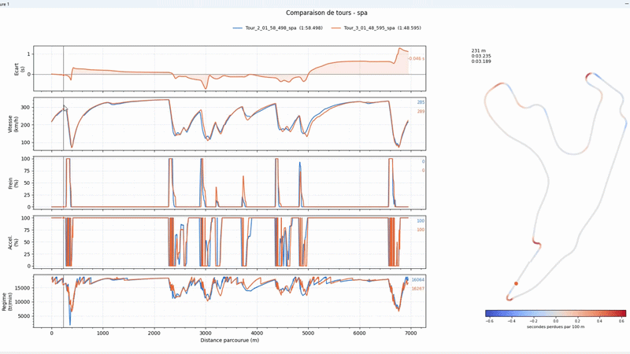

# Assetto Corsa Lap Comparator


An interactive tool to compare my own laps in Assetto Corsa, using telemetry recorded in game by a custom app.

Load two or more laps, and see exactly where time is gained or lost: cumulative time delta, speed, brake, throttle and RPM, side by side with a track map colored by time lost every 100 m.

## Demo



## Features

- **Lap comparison**: the first file is the reference, every other lap is compared against it on the same distance axis.
- **Time delta**: cumulative gap to the reference along the lap (positive = slower).
- **Telemetry channels**: speed, brake, throttle and RPM, one panel each. Channels missing from a file are skipped automatically.
- **Track map**: the circuit drawn from car position data, colored by where time is lost (red) or gained (blue).
- **Linked cursor**: hovering any chart moves a cursor across every panel and a marker on the track map, showing each lap's values and elapsed time at that exact point.
- **Large map mode**: an optional separate window with a full-size track map.

## Installation

The comparator needs Python 3. Then, from the project folder:

```bash
python -m pip install numpy pandas matplotlib
```

## Project structure

```
TelemetryExporter/
    TelemetryExporter.py   # in-game app that records each lap to CSV
lap_comparator.py          # desktop tool that compares the recorded laps
demo.gif
```

## Recording laps

Laps are recorded in game by **TelemetryExporter**, a small Python app for Assetto Corsa.

1. Copy the `TelemetryExporter` folder into your game's apps folder:
   ```
   <Assetto Corsa folder>/apps/python/TelemetryExporter/TelemetryExporter.py
   ```
   The folder and the file must have the same name.
2. Enable the app: in Content Manager, *Settings > Assetto Corsa > Apps*, or in the game's *Options > General > UI Modules*.
3. In a session, open the app from the app bar on the right side of the screen.
4. Drive. Each completed lap is saved automatically to:
   ```
   Documents/AC_Telemetry_Exports/Lap_<lap>_<MM_SS_mmm>_<track>.csv
   ```

The out lap from the pits is incomplete and is skipped. The exporter only records a sample when the car has moved forward, so the distance column is always strictly increasing.

## Usage

Compare two laps (the first one is the reference):

```bash
python lap_comparator.py reference_lap.csv other_lap.csv
```

Compare several laps at once:

```bash
python lap_comparator.py reference_lap.csv lap_2.csv lap_3.csv
```

Also open a large track map in a separate window:

```bash
python lap_comparator.py reference_lap.csv other_lap.csv --map
```

The terminal prints the lap times and the final gap of each lap to the reference, then the charts open.

## CSV format

Each file starts with metadata lines, followed by one row per recorded frame:

```
# circuit=spa
# longueur_m=7004.0
# tour=3
# temps=01_48_595
Temps(s),NSP,Distance(m),PosX,PosZ,Vitesse(kmh),RPM,Throttle(%),Brake(%)
```

| Column | Description |
|---|---|
| `Temps(s)` | Elapsed lap time |
| `NSP` | Normalized spline position: progress along the lap, from 0 to 1 |
| `Distance(m)` | `NSP` multiplied by the track length |
| `PosX`, `PosZ` | Car position on the horizontal plane, used for the track map |
| `Vitesse(kmh)` | Speed |
| `RPM` | Engine speed |
| `Throttle(%)`, `Brake(%)` | Pedal inputs |

`lap_comparator.py` requires `Temps(s)` and `Distance(m)`. Every other channel is optional: if it is missing from a file, its panel is skipped. Without `PosX` and `PosZ`, no track map is drawn.

## How it works

- **Common distance grid**: laps never have samples at the same positions, so each lap is resampled onto a shared grid of 3,000 points covering the distance all laps have in common.
- **Time delta**: at each point of the grid, the reference lap's elapsed time is subtracted from the other lap's.
- **Where time is lost**: the cumulative delta stays high after a missed corner until the end of the lap, so it does not show *where* time was lost. The track map uses its smoothed slope instead, in seconds per 100 m.
- **Clean data**: samples where distance goes backwards are removed, since interpolation needs a strictly increasing axis.
- **Smooth hovering**: the cursor uses Matplotlib blitting. The full figure is drawn once, and each mouse move only redraws the few moving elements, which keeps hovering fluid even with thousands of points.

## Tech stack

- **Python**: core language, for both the in-game app and the analysis tool
- **Assetto Corsa Python API**: live car data (`ac`, `acsys`)
- **Pandas**: CSV loading, cleaning and smoothing
- **NumPy**: interpolation and delta computation
- **Matplotlib**: charts, track map and interactive cursor

## License

This project is for educational and portfolio purposes. Assetto Corsa is a trademark of Kunos Simulazioni.
